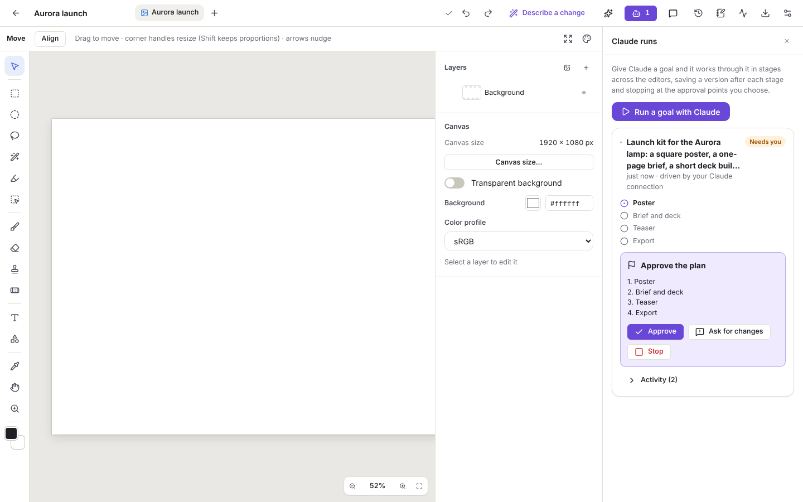
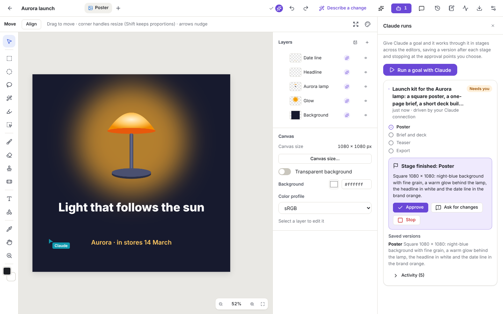
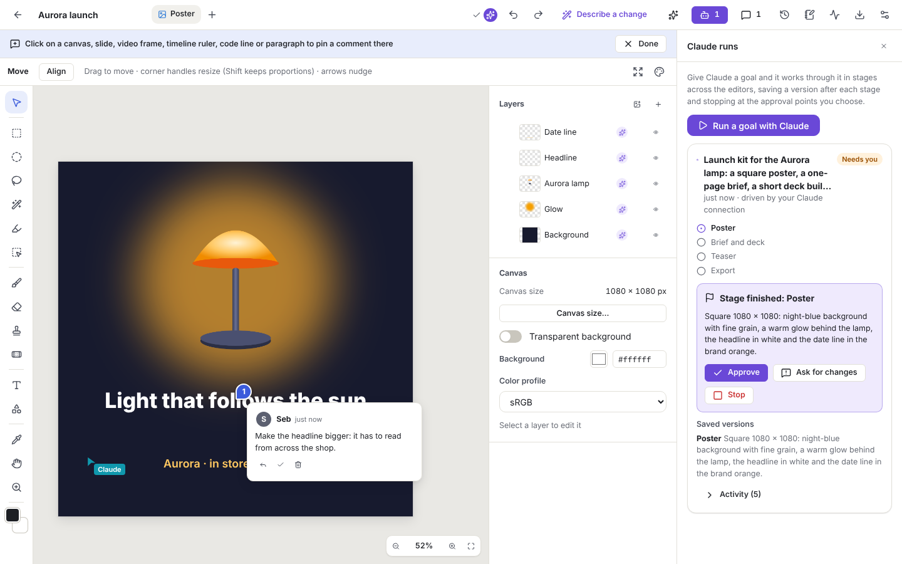
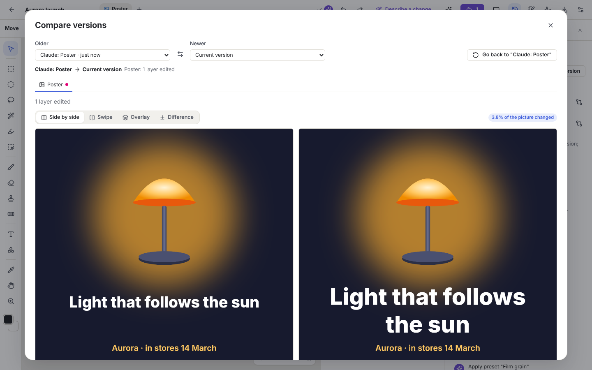
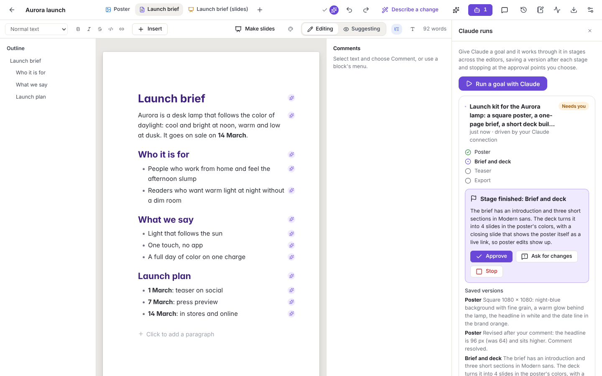
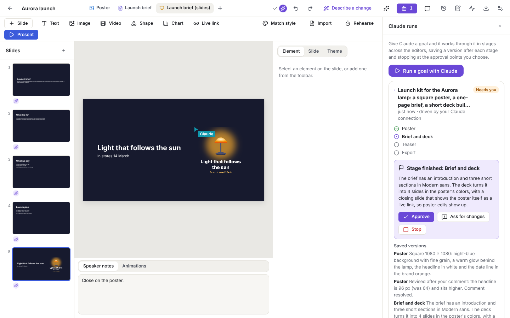
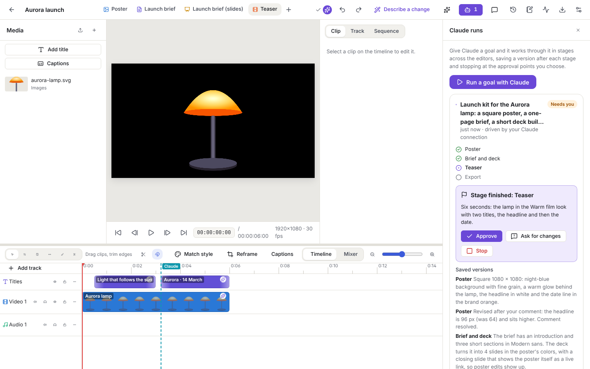
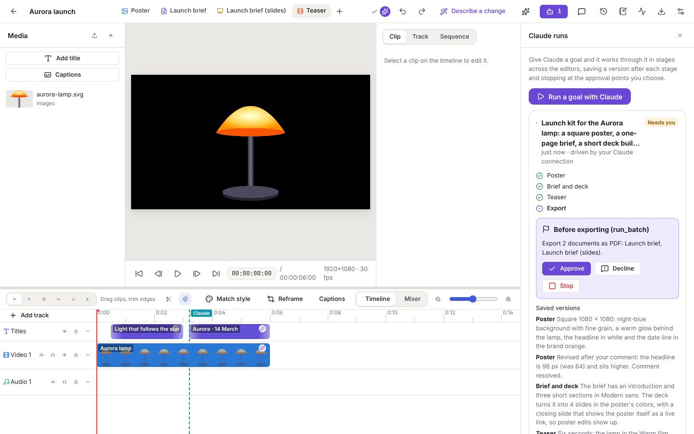
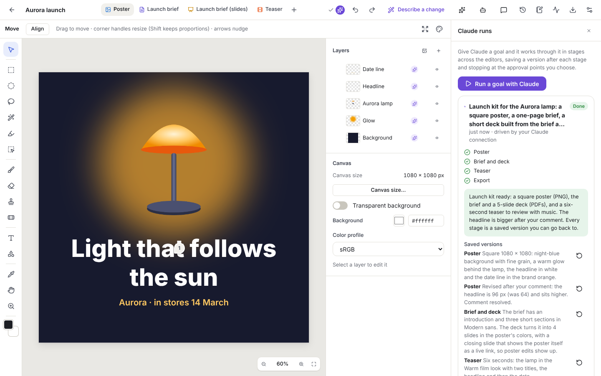
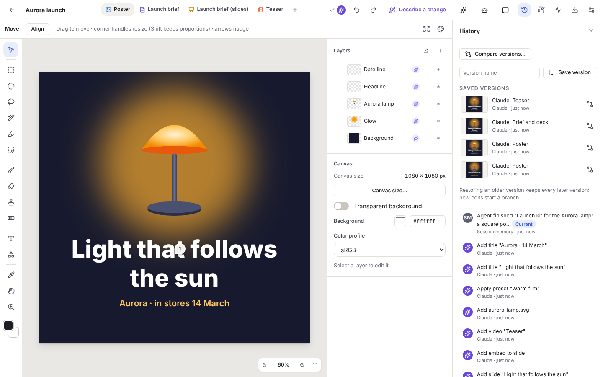

# Walkthrough: Claude makes a launch kit

This walkthrough follows one goal from start to finish. Claude is connected to Omnix over MCP in autonomous mode. The goal is a launch kit for a desk lamp called Aurora:

- a square poster
- a one-page brief
- a short deck built from the brief
- a six-second teaser
- exports for the team

Seb reviews each stage in the browser, asks for one change on the poster, compares versions and approves the exports.

> **How this was recorded.** The walkthrough is an automated test, [`e2e/walkthrough.spec.ts`](../e2e/walkthrough.spec.ts). Claude's side is an MCP client making the same tool calls Claude makes, against a real Omnix server. Seb's side is a real browser clicking through the real app. The screenshots and [`calls.json`](walkthrough/calls.json) (every tool call and Omnix's answer) come from that run. In real use Claude chooses the calls itself. Everything Omnix does in reply is exactly what is shown here.
>
> To run it again: `pnpm build`, then `OMNIX_WALKTHROUGH_DIR=docs/walkthrough pnpm test:e2e e2e/walkthrough.spec.ts`.

## Before the run

Seb uploads a product picture (`aurora-lamp.svg`) to the library and creates a project, **Aurora launch**, with **Allow AI** on. Claude is connected with the *Autonomous* permission. In real use that is **Settings → Claude**, or the approval screen Claude opens when it connects (see the [setup guide](../README.md#connect-omnix-to-claude)).

Claude starts by looking around:

| Claude calls | Omnix answers |
| --- | --- |
| `list_projects` | `1 project(s): - Aurora launch (image) id=prj_…` |
| `get_project` | `Project "Aurora launch" (image). 1 document(s). AI allowed.` |
| `list_assets` `{ query: "lamp", kind: "image" }` | `- aurora-lamp.svg [image] id=d3f6…` |

## 1. The plan

Claude starts a run with a goal and four stages:

```json
agent_start_run {
  "goal": "Launch kit for the Aurora lamp: a square poster, a one-page brief, a short deck built from the brief and a six-second teaser, in one look, exported for the team.",
  "plan": ["Poster", "Brief and deck", "Teaser", "Export"]
}
```

Seb's usual approvals apply. Seb approves the plan first, then reviews each finished stage, and anything Claude exports or deletes waits for Seb too. Until Seb answers, Omnix holds every change Claude tries to make in this project. Claude calls `agent_wait` and waits.



Seb clicks **Approve**. `agent_wait` returns `Approved. Continue with: Poster.`

## 2. The poster

Claude builds the poster in the image editor:

1. `update_node` makes the canvas 1080 × 1080 and names it Poster.
2. `update_node` makes the background night blue.
3. `apply_preset` "Film grain" adds a little texture.
4. `image_add_layer` adds an orange ellipse, and `image_add_filter` blurs it by 130 px into a glow.
5. `image_add_layer` places the lamp from the library, a white headline and a date line in the brand orange.

Then it checks its own work with `render_preview`. This is the picture Claude sees:


`agent_checkpoint` saves a version named **Claude: Poster** and pauses for Seb's review. In the editor, a sparkle marks each layer Claude changed, and Claude's cursor shows where it last worked.



### A comment, and a revision

Seb thinks the headline is too small. They switch on comment mode (Ctrl+Alt+M), clicks on the headline and writes a comment.



Then they click **Ask for changes** and write "See my comment on the headline." Claude's `agent_wait` returns:

```
The user asked for changes: See my comment on the headline. Address them, then checkpoint again.
```

Claude reads the open comments. Omnix tells it which layer the pin is on:

```
list_comments → - cmt_… (Poster at (540, 725), over the layer "Headline") Seb: Make the headline bigger: it has to read from across the shop.
```

Claude enlarges the headline from 64 to 96 px with `update_node`. It replies to the comment and resolves it with `resolve_comment`, and checks the change against the version Seb reviewed:

```
compare_versions → Comparing "Claude: Poster" → "Current version".
                   Poster: 1 layer edited
                   3.9% of the picture changed (area x 95, y 472, 579×136 at preview scale).
```

It checkpoints the stage again; the stage stays *Poster* until Seb approves it. Seb opens **History** and compares the version they reviewed with the revision side by side. Swipe, overlay and difference views are also there.



Seb approves. `agent_wait`: `Approved. Continue with: Brief and deck.`

## 3. The brief and the deck

Claude adds a document with `add_document` and writes the brief with `doc_insert_markdown`: an introduction and three sections, *Who it is for*, *What we say* and *Launch plan*. It applies the "Modern sans" document style with `apply_preset`.



`slides_from_document` turns the brief into a deck:

- a title slide, with the introduction as its subtitle
- one slide per section

`slides_set_theme` gives the deck the poster's colors and fonts. Claude adds a closing slide with `slides_add_slide`, and puts the poster on it with `slides_add_element` as an **embed**. The embed is a live link, so changes to the poster appear on the slide.



Seb approves the stage.

## 4. The teaser

Claude adds a video sequence and builds the teaser:

- `video_add_clip` places the lamp picture as a six-second still.
- `apply_preset` gives the clip the "Warm film" look.
- `video_add_title` adds two titles: the headline, then the date.

Claude checks a frame with `render_preview` (`Rendered "Teaser" (sequence) at 1.5 s, 512×288.`) and checkpoints.



## 5. Exports, each one approved

Claude exports the brief and the deck as PDFs in one batch with `run_batch` and `document.export`. Exporting waits for Seb, and Omnix tells Claude so:

```
Paused for the user's approval (Before exporting (run_batch)). Call agent_wait …; once approved, call run_batch again with the same arguments.
```

Seb sees exactly what will be exported:



After Seb approves, the same call goes through:

```
Export · 2 items: done
- Launch brief: done → Launch-brief.pdf
- Launch brief (slides): done → Launch-brief-slides.pdf
```

The poster PNG (`export_file`) asks for approval separately, because one approval covers exactly one call. The files are saved in the library, and each comes with a download link that works for 24 hours.

## 6. Done

Claude finishes the run with a summary for Seb. The summary is kept in the project's session memory, so the next session, Seb's or Claude's, starts with it.



Every stage is a saved version Seb can compare with, or go back to:



## What this exercised

| Area | Where |
| --- | --- |
| **Autonomous runs**: plan approval, stage reviews, asking for changes, export approvals, holding writes while paused | Throughout |
| **Comments pinned to content**: Claude finds the layer under a pin, then replies and resolves | §2 |
| **Versions**: a version per stage, and comparison as pictures and as a structured diff | §2, §6 |
| **Presets** for layer effects, document styles and clip looks | §2–4 |
| **Working across tools**: a deck from a document, and a live embed of the poster | §3 |
| **Batch processing** over several documents | §5 |
| **Asset library**: an uploaded picture used in a canvas, a slide and a video | §2–4 |
| **Attribution**: AI markers on changed layers, blocks, clips and slides; every commit credited to Claude or Seb | Throughout |

## Problems this walkthrough found

Building this run end to end found problems the feature tests had missed. All of them are fixed, with tests:

- **SVG pictures did not draw in the editors.** Browsers cannot decode SVG through `createImageBitmap`.
- **Comment cards on a canvas were see-through.** Their styles only loaded once a document had been opened.
- **Exports and merges could skip their approvals.** An approval request for an export or a deletion could be skipped through batch processing (`run_batch` with export), merging files, or a plain-language command. Every tool was also announced to Claude with `destructiveHint: false`.
- **Asking for changes did not reopen the stage.** The run moved on to the next stage while the old one was still being revised.
- **Large blurs were slow.** Each preview of a glow blurred by 130 px took seconds.
- **Writing into a new document left a blank line, and the deck repeated the title.** `slides_from_document` also counted the slides it made wrongly.
- **Slides toolbar hid Present when a side panel was open.**
